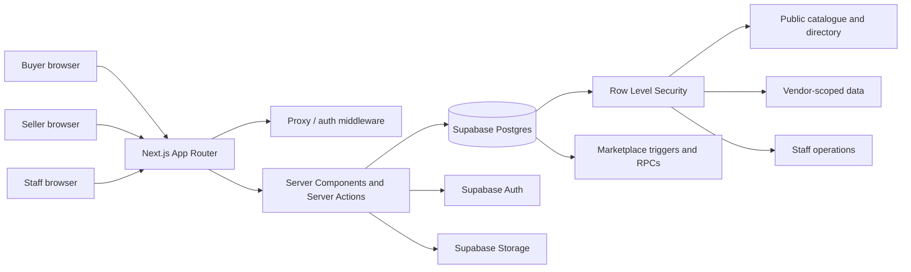
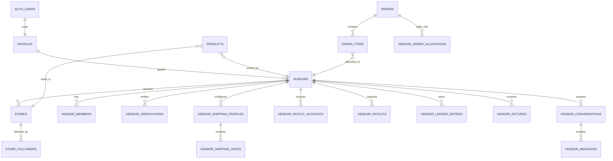
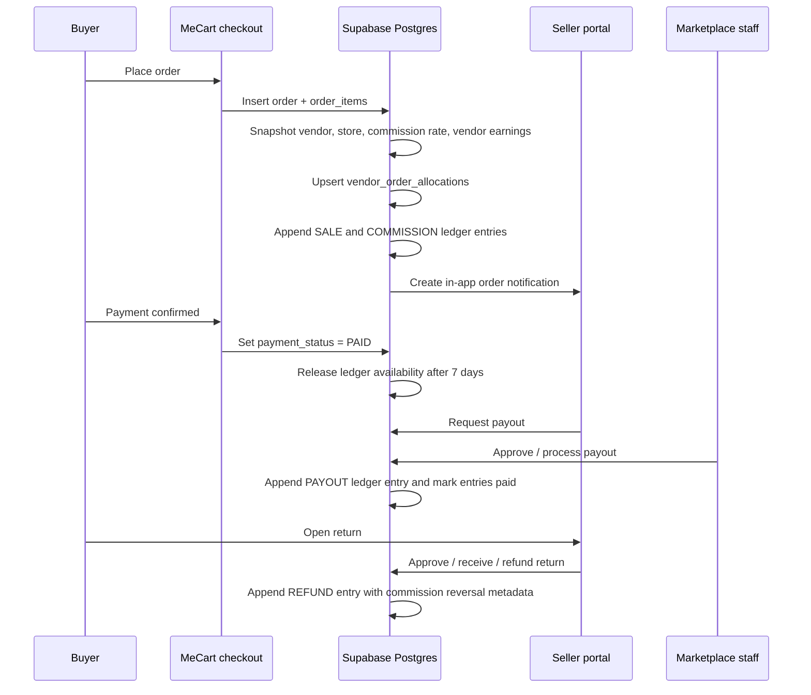

# MeCart Multi-Vendor Marketplace — Final Delivery Report

**Date:** 2026-10-22  
**Scope:** Production-grade multi-vendor marketplace layered onto the existing MeCart commerce application.  
**Status:** Marketplace foundation complete and validated. Existing commerce, AI, PWA, auth, admin, and luxury storefront behavior preserved.

---

## 1. Executive summary

MeCart now supports:

- Vendors with many stores each.
- Seller onboarding, team roles, product submission, and staff moderation.
- Marketplace-wide product, store, and vendor discovery.
- Commission calculation with immutable order-item snapshots.
- Vendor order allocations, ledger entries, payouts, returns, and refund reversal metadata.
- Buyer-to-seller messaging and store following.
- Full staff marketplace operations: vendor review, product approval, store control, payout processing, return resolution, commission policy, and product ownership assignment.
- Public storefront and seller/admin portals built on the existing design systems.

The implementation is **additive**. Existing platform-owned products remain valid with `vendor_id = null`; existing tables and APIs were extended rather than replaced. Supabase Auth remains the identity provider, and the existing `admin` / `manager` / `customer` / `guest` role model is preserved.

### Completion snapshot

| Area | Status |
|---|---|
| Marketplace schema, triggers, RPCs, indexes | Complete |
| Row Level Security and public read paths | Complete |
| Seller portal | Complete |
| Public storefront, vendor directory, store pages | Complete |
| Buyer messaging and store following | Complete |
| Admin marketplace operations | Complete |
| Commission, ledger, payout, return workflows | Complete |
| Type regeneration | Complete |
| TypeScript, lint, production build | Passing |
| Schema lint | No errors |
| Security advisors, error level | No issues |
| Performance advisors, error level | No issues |
| Live smoke tests | Passing |
| External card/bank payout rail | Deployment/integration item |
| Commit / push | Not performed |

---

## 2. Architecture

### 2.1 System context



### 2.2 Marketplace domain model



### 2.3 Order, commission, and payout flow



### 2.4 Key architecture decisions

1. **One auth system.** Supabase Auth remains authoritative. Vendor identity is a profile-owned record, not a second auth provider.
2. **One vendor, many stores.** `stores.vendor_id` is the ownership boundary. Product ownership uses `vendor_id` and optional `store_id`.
3. **Already-public catalogue preserved.** Platform products keep `vendor_id = null` and remain approved. Seller products are held to moderation.
4. **Financial snapshots, not live recalculation.** Commission rate and vendor earnings are stored on `order_items` and allocations at order time.
5. **Append-only money movement.** Ledger entries are written by triggers/RPCs and are not editable through normal client RLS.
6. **Safe public projections.** Public vendor data is exposed through a security-definer function and a `security_invoker` view, not by opening the `vendors` table.
7. **No parallel architecture.** Existing repositories, server actions, admin shell, design tokens, and route groups were extended in place.

---

## 3. Database schema

### 3.1 Marketplace enums

`vendor_status`, `vendor_verification_status`, `vendor_member_role`, `vendor_store_status`, `vendor_product_approval`, `vendor_fulfillment_status`, `vendor_payout_status`, `vendor_return_status`, `vendor_ledger_type`, `vendor_message_sender`, `vendor_conversation_status`.

### 3.2 New tables (16)

| Table | Purpose | Important relationships / guarantees |
|---|---|---|
| `vendors` | Seller legal and storefront identity | `owner_id -> profiles`; status, verification, commission rate, aggregates, soft delete |
| `stores` | Multiple storefronts per vendor | `vendor_id -> vendors`; slug unique; ACTIVE status gates public visibility |
| `vendor_members` | Team membership and permissions | `vendor_id`, `user_id`; OWNER/ADMIN/MANAGER/ANALYST/SUPPORT; owner membership protected by trigger |
| `vendor_verifications` | KYC/business review record | Vendor-scoped documents and staff review state |
| `vendor_shipping_profiles` | Reusable shipping configurations | Default profile per vendor; processing windows |
| `vendor_shipping_rates` | Country/region/weight rate rules | Belongs to a shipping profile and vendor |
| `vendor_payout_accounts` | Masked payout destinations | Provider, masked account data, verification state |
| `vendor_payouts` | Payout request and processing lifecycle | Period totals, net amount, status, reviewer, reference |
| `vendor_ledger_entries` | Append-only vendor money ledger | SALE, COMMISSION, REFUND, ADJUSTMENT, PAYOUT, RESERVE_RELEASE |
| `vendor_order_allocations` | Per-vendor order split | Unique `(order_id, vendor_id, store_id)`; commission snapshot and fulfillment state |
| `vendor_returns` | RMA and refund workflow | Order/item/vendor linkage; refund amount and commission reversal |
| `vendor_conversations` | Buyer-seller threads | Buyer, vendor, optional store/order; status and last-message preview |
| `vendor_messages` | Thread messages | Sender type, optional attachments, read timestamp |
| `vendor_notifications` | Seller in-app alerts | Vendor/user scoped, typed, read state |
| `vendor_audit_logs` | Vendor-scoped audit trail | Actor, action, resource, JSON metadata |
| `store_followers` | Store follow graph | Unique store/user relationship; follower count synchronized |

### 3.3 Additive columns on existing commerce tables

| Existing table | Added marketplace fields |
|---|---|
| `products` | `vendor_id`, `store_id`, `vendor_sku`, `commission_rate`, `approval_status`, `approval_notes`, `submitted_at`, `approved_at`, `approved_by`, `shipping_profile_id`, `marketplace_metadata` |
| `orders` | `marketplace_order`, `vendor_count` |
| `order_items` | `vendor_id`, `store_id`, `vendor_sku`, `commission_rate`, `commission_amount`, `vendor_earnings` |
| `coupons` | `vendor_id`, `store_id` |
| `reviews` | `vendor_id`, `store_id`, `vendor_reply`, `vendor_replied_at` |

### 3.4 Public projection

- `public_vendor_profiles` is a **security-invoker view** over `marketplace_public_vendor_directory()`.
- The function returns only `APPROVED`, non-deleted vendors and only safe storefront columns.
- Sensitive vendor fields such as tax IDs, legal contact data, and verification documents are not exposed to anonymous visitors.

### 3.5 Indexes and query paths

The live database currently contains **65 marketplace indexes**, including:

- Vendor status, owner, slug, and trigram display-name indexes.
- Store vendor/status/slug/trigram indexes.
- Product vendor, store, approval, status, slug, and trigram indexes.
- Allocation uniqueness and order/vendor access indexes.
- Ledger vendor, availability, order, and payout indexes.
- Conversation last-message, customer, and vendor indexes.
- Message conversation/read indexes.
- Payout, return, notification, audit, and follower access indexes.

### 3.6 Triggers and RPCs

Important triggers:

- `enforce_product_vendor_store` — validates store ownership, snapshots commission, and forces seller-created products to `PENDING`.
- `protect_product_marketplace_fields` — blocks non-staff changes to approval and financial fields.
- `snapshot_order_item_marketplace` — freezes commission data at order time.
- `allocate_vendor_order_item` — upserts allocations, updates totals, appends ledger entries, and notifies the seller.
- `sync_marketplace_order_paid` — releases ledger availability on payment.
- `protect_vendor_allocation_financials` — protects marketplace-calculated money fields.
- `protect_vendor_owner_membership` — prevents removal/demotion of the vendor owner through team controls.
- `sync_store_follower_count`, `sync_store_product_counters`, `refresh_vendor_rating`, `refresh_product_rating`, `sync_vendor_publication`.
- `set_updated_at` on all timestamped marketplace tables.

Key RPCs:

- `create_vendor_application(payload)`
- `request_vendor_payout(vendor_id)`
- `process_vendor_payout(payout_id, status, reference, notes)`
- `process_vendor_return(return_id, status, refund_amount, notes)`
- `log_vendor_audit(vendor_id, action, resource, metadata)`
- `marketplace_public_vendor_directory()`
- `marketplace_public_vendor_exists(vendor_id)`
- `marketplace_public_store_exists(store_id)`
- `is_vendor_member`, `is_vendor_admin`, `has_vendor_permission`
- `can_access_vendor_order`, `can_access_vendor_conversation`

### 3.7 Commission and ledger behavior

Commission resolution order:

1. Explicit product commission, when provided.
2. Vendor commission rate.
3. `settings.marketplace.default_commission`.
4. Hard fallback of `10%`.

On order-item creation:

- The vendor, store, commission rate, commission amount, and vendor earnings are snapshotted.
- An allocation is created or incremented.
- `SALE` and negative `COMMISSION` ledger entries are appended.
- Funds become available after the configured seven-day hold.

On return/refund:

- A negative `REFUND` ledger entry is appended.
- `commission_reversal` is recorded in ledger metadata, audit logs, and vendor notifications.

---

## 4. Routes and surfaces

### 4.1 Public marketplace

| Route | Purpose |
|---|---|
| `/stores` | Public store directory with search, featured state, and vendor attribution |
| `/stores/[slug]` | Storefront, product listing, follow, contact, shipping/return policies |
| `/vendors/[slug]` | Public vendor profile and its active stores |
| `/messages` | Authenticated buyer-seller conversation list and thread |
| `/search` | Marketplace-aware search across products, stores, and vendors |
| `/products/[slug]` | Existing product detail, now with store/vendor attribution |
| `/orders/[id]` and `/orders/[id]/track` | Existing order detail and tracking, now marketplace-aware |
| `/sitemap.xml` | Includes public stores and vendors |
| `/robots.txt` | Blocks seller, admin, messages, and account areas |

### 4.2 Seller portal

All seller routes are protected by auth and vendor context.

| Route | Purpose |
|---|---|
| `/seller` | Seller dashboard |
| `/seller/onboarding` | Vendor application and store setup |
| `/seller/products` | Product list and moderation state |
| `/seller/products/new` | Create seller product (enters PENDING) |
| `/seller/products/[id]/edit` | Edit owned product |
| `/seller/orders` | Vendor order allocations |
| `/seller/orders/[id]` | Order detail and fulfillment |
| `/seller/inventory` | Stock management |
| `/seller/customers` | Vendor customer view |
| `/seller/coupons` | Vendor coupon controls |
| `/seller/analytics` | Sales and catalogue analytics |
| `/seller/messages` | Buyer conversations |
| `/seller/reviews` | Product reviews and vendor replies |
| `/seller/finance` | Ledger, commissions, and net balance |
| `/seller/payouts` | Payout requests and history |
| `/seller/shipping` | Shipping profiles and rates |
| `/seller/returns` | RMA and refund handling |
| `/seller/stores` | Store list and create |
| `/seller/stores/[id]` | Store branding, policies, and status |
| `/seller/settings` | Team, vendor profile, and payout account settings |
| `/seller/notifications` | Seller in-app notifications |

### 4.3 Admin marketplace

| Route | Purpose |
|---|---|
| `/admin/marketplace` | Marketplace operations overview |
| `/admin/marketplace/vendors` | Vendor review queue and status |
| `/admin/marketplace/vendors/[id]` | Vendor detail, verification, commission, suspension |
| `/admin/marketplace/products` | Product moderation queue |
| `/admin/marketplace/stores` | Store status and publication control |
| `/admin/marketplace/payouts` | Payout approval/processing |
| `/admin/marketplace/returns` | Return review and refund resolution |
| `/admin/marketplace/commissions` | Global and per-vendor commission policy |
| `/admin/marketplace/ownership` | Assign product ownership to vendor/store |

---

## 5. Security implementation

### 5.1 Identity and RBAC

- Supabase Auth remains the only identity provider.
- Platform roles remain `admin`, `manager`, `customer`, `guest`.
- Vendor team roles are separate: `OWNER`, `ADMIN`, `MANAGER`, `ANALYST`, `SUPPORT`.
- Vendor permissions are checked through `has_vendor_permission`, `is_vendor_admin`, and `is_vendor_member`.
- Staff checks use `is_staff` / `is_admin`; staff retain full marketplace operations.

### 5.2 Seller product moderation

- Seller-created products are forced to `PENDING` by trigger, regardless of the submitted payload.
- `submitted_at` is recorded.
- Only staff can change `approval_status`, `approved_at`, or `approved_by`.
- Public product RLS requires all of:
  - `deleted_at is null`
  - `status = 'ACTIVE'`
  - `approval_status = 'APPROVED'`
  - the vendor, if any, is approved and not deleted
  - the store, if any, is active and not deleted
- A seller product therefore cannot become public by editing the product row directly.

### 5.3 RLS model

The live database has **41 policies across the 16 marketplace tables**, plus marketplace-aware policies on existing commerce tables.

| Domain | Access model |
|---|---|
| Public storefront | Anonymous reads only for active stores, approved products, approved vendors, approved reviews, and safe vendor projection |
| Vendor data | Members read their vendor; admins/managers write according to vendor permission |
| Buyer data | Buyers read their own conversations, returns, and orders |
| Staff | Full read/write through `is_staff()` policies |
| Financial ledger | Vendor read-only visibility; writes through security-definer triggers/RPCs |
| Payouts | Vendor requests; staff approves/processes |
| Returns | Buyer requests; vendor/staff resolve; refund writes are RPC-controlled |
| Audit logs | Vendor admins and staff; append through audited RPCs |
| Storage | Vendor assets and documents scoped by vendor folder and active membership |

Representative policy counts by table: `products` 9, `reviews` 6, `stores` 5, `orders` 4, `vendors` 3, `coupons` 3, `vendor_returns` 3, `vendor_conversations` 3, `vendor_messages` 3, `store_followers` 3.

### 5.4 Public read-path correction found during smoke testing

A live smoke test exposed a real RLS defect:

- The original `stores_public_read` and `products_public_read` policies used `exists (... from public.vendors ...)`.
- That subquery runs with the caller's RLS. Anonymous visitors have no select policy on `vendors`, so the subquery returned no rows.
- Result: active stores and vendor-owned products disappeared from the public storefront even when correctly approved.

Fix in `20261022000600_marketplace_public_read_fix.sql`:

- Added narrow security-definer predicates:
  - `marketplace_public_vendor_exists(vendor_id)`
  - `marketplace_public_store_exists(store_id)`
- Recreated the public store and product policies to use those predicates.
- The predicates expose only a boolean publication check, never vendor rows or sensitive fields.

This was validated with a temporary approved vendor, active store, and approved product: store directory, store detail, vendor detail, product detail, and store product listing all returned the expected content. All fixture rows were deleted afterward.

### 5.5 RPC and function hardening

Removed or restricted:

- Dropped `debug_pw(uuid)` and `debug2_pw(uuid)`.
- Revoked trigger-only functions from `public`, `anon`, and `authenticated`.
- Revoked OTP and password-metadata helpers from client roles; they remain service-role server-action helpers.
- Revoked anon execution of `log_vendor_audit`.
- Restricted payout, return, onboarding, and internal commission functions to their intended roles.
- Pinned `search_path` on `set_updated_at` and `marketplace_slugify`.
- Kept `place_order`, `merge_guest_cart`, `validate_coupon_code`, and `check_signup_available` available where guest flows require them.

### 5.6 Accepted security-advisor warnings

Latest successful advisor run:

- **Security errors: 0**
- **Performance errors: 0**
- **Schema lint errors: 0**

Remaining warnings:

| Warning | Count | Decision |
|---|---:|---|
| `anon_security_definer_function_executable` | 16 | Intentional RLS predicates, public directory, guest checkout/coupon helpers, and read-only authorization booleans |
| `authenticated_security_definer_function_executable` | 21 | Intentional vendor/staff RPC surface and RLS helpers |
| `auth_allow_anonymous_sign_ins` | 56 | Project-level auth configuration; keep only if guest sessions require it |
| `auth_leaked_password_protection` | 1 | Enable in Supabase Auth before launch |
| `extension_in_public` (`pg_trgm`) | 1 | Accepted for now; move to `extensions` schema in a controlled maintenance window |
| `multiple_permissive_policies` | 55 | Layered public/vendor/staff policies; consolidate only if load testing shows overhead |

The 16 anonymous security-definer functions are:

`can_access_vendor_conversation`, `can_access_vendor_order`, `check_signup_available`, `current_app_role`, `has_permission`, `has_vendor_permission`, `is_admin`, `is_staff`, `is_vendor_admin`, `is_vendor_member`, `marketplace_public_store_exists`, `marketplace_public_vendor_directory`, `marketplace_public_vendor_exists`, `merge_guest_cart`, `place_order`, `validate_coupon_code`.

The 21 authenticated functions add vendor mutations and staff operations, including `create_vendor_application`, `log_vendor_audit`, `process_vendor_payout`, `process_vendor_return`, and `request_vendor_payout`.

### 5.7 Deployment security actions

Before live marketplace payouts:

1. Enable Supabase leaked-password protection.
2. Decide whether anonymous Supabase sign-ins are required. If not, disable them.
3. Move `pg_trgm` to the `extensions` schema during a maintenance window, or document the accepted risk.
4. Configure SMTP, rate limits, CAPTCHA/Turnstile, and WAF rules at the edge.
5. Connect a real payout rail (Stripe Connect, PayPal, or bank transfer) before moving money. The current payout workflow records and audits the lifecycle but is provider-agnostic.
6. Set up encrypted backups/PITR and test restore procedures.
7. Review the 55 overlapping permissive policies after production-shaped load testing.

---

## 6. Files delivered

### 6.1 Migrations

| File | Purpose |
|---|---|
| `supabase/migrations/20261022000100_marketplace_foundation.sql` | Core schema, enums, triggers, RPCs, indexes, RLS, public view |
| `supabase/migrations/20261022000200_marketplace_storage.sql` | Vendor asset/document buckets and storage policies |
| `supabase/migrations/20261022000300_marketplace_followers.sql` | Follower-count synchronization |
| `supabase/migrations/20261022000400_marketplace_return_commission_metadata.sql` | Return commission reversal metadata |
| `supabase/migrations/20261022000500_marketplace_security_hardening.sql` | Debug RPC removal, trigger revocation, safe public directory, search-path hardening |
| `supabase/migrations/20261022000600_marketplace_public_read_fix.sql` | Fixes anonymous public store/product visibility |
| `supabase/migrations/20261022000700_marketplace_rpc_least_privilege.sql` | Removes anon access to `log_vendor_audit` |
| `supabase/migrations/20261022000800_otp_policy_performance.sql` | Caches auth helpers in OTP self-read policies |

### 6.2 Types

- `types/database.gen.ts` — regenerated from the linked Supabase schema after all structural migrations.
- `types/database.ts` — friendly row/enum aliases and `Database` export.
- `types/marketplace-database.ts` — marketplace schema augmentation and strongly typed public vendor view.

### 6.3 Repositories, actions, and domain helpers

- `lib/repositories/marketplace.ts`
- `lib/repositories/seller.ts`
- `lib/repositories/admin-marketplace.ts`
- `lib/actions/vendor.ts`
- `lib/actions/seller-products.ts`
- `lib/actions/seller-operations.ts`
- `lib/actions/admin-marketplace.ts`
- `lib/actions/marketplace-buyer.ts`
- `lib/marketplace/context.ts`
- `lib/marketplace/format.ts`
- `lib/marketplace/permissions.ts`
- `lib/supabase/public.ts`
- `lib/supabase/browser.ts`

### 6.4 Public storefront and buyer experience

- `app/(shop)/stores/page.tsx`
- `app/(shop)/stores/[slug]/page.tsx`
- `app/(shop)/vendors/[slug]/page.tsx`
- `app/(shop)/messages/page.tsx`
- `components/marketplace/store-card.tsx`
- `components/marketplace/vendor-card.tsx`
- `components/marketplace/store-engagement.tsx`
- `components/marketplace/customer-conversation.tsx`
- `app/sitemap.ts`, `app/robots.ts`
- Integration changes in `components/shop/shop-navbar.tsx`, `components/shop/site-footer.tsx`, `app/(shop)/layout.tsx`, `app/(shop)/search/page.tsx`, `app/(shop)/products/[slug]/page.tsx`, `app/(shop)/orders/[id]/page.tsx`, and `app/(shop)/orders/[id]/track/page.tsx`.

### 6.5 Seller portal

- All routes under `app/seller/`:
  - dashboard, onboarding, analytics, coupons, customers, finance, inventory, messages, notifications, orders, order detail, payouts, products, product create/edit, returns, reviews, settings, shipping, stores, and store detail.
- Components under `components/seller/`:
  - shell, onboarding form, product form, stock editor, shipping controls, fulfillment form, finance view/controls, payout controls, return actions, review reply, coupon controls, conversation, store form, team controls, notification controls, vendor settings, and shared UI.

### 6.6 Admin marketplace

- `app/admin/marketplace/page.tsx`
- `app/admin/marketplace/vendors/page.tsx`
- `app/admin/marketplace/vendors/[id]/page.tsx`
- `app/admin/marketplace/products/page.tsx`
- `app/admin/marketplace/stores/page.tsx`
- `app/admin/marketplace/payouts/page.tsx`
- `app/admin/marketplace/returns/page.tsx`
- `app/admin/marketplace/commissions/page.tsx`
- `app/admin/marketplace/ownership/page.tsx`
- `components/admin/marketplace/controls.tsx`

### 6.7 Integration and protection

- `proxy.ts` — `/messages` matcher.
- `lib/supabase/middleware.ts` — `/messages` auth protection.
- `lib/supabase/public.ts` — cookieless public read client.
- `types/database.gen.ts`, `types/database.ts`, `types/marketplace-database.ts`.
- `lib/actions/admin-marketplace.ts` and `lib/actions/seller-operations.ts` — nullable optional RPC arguments aligned with generated types.

> The working tree also contains pre-existing storefront, PWA, AI, and commerce refinements. These were preserved; the list above focuses on marketplace delivery and its direct integration points.

---

## 7. Validation evidence

### 7.1 Static and build checks

| Command | Result |
|---|---|
| `npx tsc --noEmit` | Pass |
| `npm run lint` | Pass, no warnings or errors |
| `npm run build` | Pass, Next.js 16.4.2 / Turbopack |
| `npx supabase db lint --linked --schema public --level warning` | No schema errors |
| `npx supabase db advisors --linked --type security --level error` | No issues |
| `npx supabase db advisors --linked --type performance --level error` | No issues |
| `npx supabase db advisors --linked --type performance --level warn` | 55 `multiple_permissive_policies` warnings only |

The production build includes all marketplace, seller, storefront, messaging, sitemap, and admin routes. The only build warning is the pre-existing Turbopack note that `package-lock.json` sits outside the Git repository root; it is non-blocking.

### 7.2 Production smoke test

A production server was started with `npm run start` and exercised with HTTP requests.

| Route group | Result |
|---|---|
| `/`, `/products`, `/categories`, `/search`, `/stores`, `/cart`, `/about`, `/contact`, `/login`, `/register`, `/offline`, `/rewards` | 200 |
| `/sitemap.xml`, `/robots.txt` | 200 |
| Unknown vendor/store slugs | 404, no server error |
| `/messages`, `/orders`, `/wishlist`, `/profile`, `/checkout` | 307 to `/login?callbackUrl=...` |
| `/seller`, `/seller/onboarding`, `/seller/products/new` | 307 to login |
| `/admin`, `/admin/marketplace`, all marketplace subroutes | 307 to login |
| Unexpected 5xx responses | 0 |

### 7.3 Marketplace fixture test

A temporary approved vendor, active store, and approved product were created to validate the real public read path:

- `/stores` returned the store.
- `/stores/[slug]` returned the store and listed the approved product.
- `/vendors/[slug]` returned the vendor profile.
- `/products/[slug]` returned the product detail.
- The seller product initially entered `PENDING` through the trigger, confirming moderation enforcement.
- Staff-context approval made it public.
- All fixture rows were deleted and verified at zero afterward.

### 7.4 Migration state

Applied to the linked Supabase project:

- `20261022000100_marketplace_foundation.sql`
- `20261022000200_marketplace_storage.sql`
- `20261022000300_marketplace_followers.sql`
- `20261022000400_marketplace_return_commission_metadata.sql`
- `20261022000500_marketplace_security_hardening.sql`
- `20261022000600_marketplace_public_read_fix.sql`
- `20261022000700_marketplace_rpc_least_privilege.sql`
- `20261022000800_otp_policy_performance.sql`

---

## 8. Scale and future expansion

### 8.1 What is already in place for scale

- Composite and partial indexes for status, vendor, store, slug, approval, ledger, and message access paths.
- Trigram indexes for marketplace search.
- Snapshot-based financial calculations, avoiding repeated joins at payout time.
- Counter synchronization triggers for ratings, followers, and product counts.
- Cookieless public reads for cache-friendly storefront traffic.
- RLS predicates that use primary-key lookups and indexed status columns.
- Security-definer public directory that avoids exposing the vendor table.
- Bounded public list queries and pagination-ready repository methods.

### 8.2 Recommended next steps for 10k vendors / 1M products

1. **Search:** move from trigram-only search to Postgres `tsvector` or an external engine (Meilisearch/Typesense/OpenSearch) for relevance, typo tolerance, and faceting.
2. **Caching:** add Redis/Upstash for storefront directory pages, vendor profiles, and marketplace statistics; invalidate on vendor/store/product publication events.
3. **Read scaling:** use Supabase read replicas for public catalogue queries and analytics.
4. **Ledger scale:** partition `vendor_ledger_entries`, `vendor_audit_logs`, and `vendor_notifications` by time or vendor when row counts grow.
5. **Async work:** introduce an outbox/queue for emails, notifications, payout reconciliation, search indexing, and image processing. Do not do slow external work inside triggers.
6. **Payouts:** integrate Stripe Connect or a local payout provider, including KYC, destination verification, transfer state, webhooks, and reconciliation.
7. **Shipping:** connect carrier APIs for live rates, label generation, tracking updates, and address validation.
8. **Returns:** automate reverse-ledger settlement, restocking, and refund provider calls.
9. **Moderation:** add image/content moderation, seller trust tiers, automated policy checks, and appeal workflows.
10. **Messaging:** enable Supabase Realtime, attachment scanning, abuse reporting, and retention controls.
11. **Observability:** add structured logs, OpenTelemetry traces, error tracking, queue depth, payout reconciliation dashboards, and alerting.
12. **Testing:** add Playwright E2E coverage for seller onboarding, product approval, checkout split, payout, return, and messaging; add a dedicated RLS test suite that runs as `anon`, customer, vendor member, and staff.
13. **Compliance:** add GDPR export/delete, marketplace tax reporting, invoice retention, sanctions/KYC checks, and PCI-scoped payment handling.

### 8.3 Explicit production caveat

The marketplace **records** vendor payouts and refunds correctly, and the ledger is auditable. The actual movement of money to a vendor bank account or connected account still requires an external payout provider integration. That is an operational/provider task, not a missing marketplace data model.

---

## 9. Operational runbook

### Regenerate types after a migration

```bash
npx supabase gen types typescript --linked > types/database.gen.ts
npx tsc --noEmit
```

### Validate the database and application

```bash
npx supabase db lint --linked --schema public --level warning
npx supabase db advisors --linked --type security --level error
npx supabase db advisors --linked --type performance --level error
npx tsc --noEmit
npm run lint
npm run build
```

### Apply migrations

```bash
npx supabase db push --linked
```

### Launch checklist

- [ ] Enable leaked-password protection.
- [ ] Confirm anonymous-sign-in policy.
- [ ] Configure SMTP and notification delivery.
- [ ] Configure payment and payout providers.
- [ ] Configure carrier integrations and tracking webhooks.
- [ ] Run a full RLS role test against production-shaped data.
- [ ] Seed/verify commission policy and default settings.
- [ ] Configure backups, PITR, and restore test.
- [ ] Set up monitoring, alerting, and rate limits.
- [ ] Complete legal review for marketplace terms, returns, tax, and KYC.

---

## 10. Final status

The marketplace foundation is integrated, migrated, type-checked, linted, built, and smoke-tested.

- **Code blockers:** none.
- **Schema/RLS blockers:** none at error level.
- **Remaining launch work:** deployment configuration and external provider integrations (payouts, shipping, email/SMS, observability).
- **Changes remain uncommitted**; no commit or push was requested.
